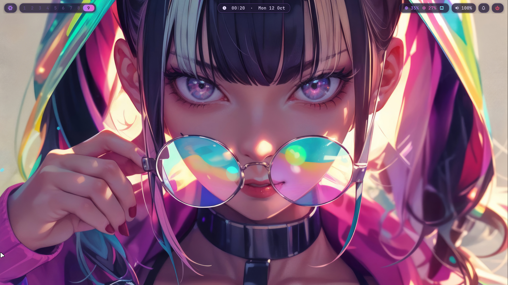

<div align="center">

# nixos-s1b

**NixOS × mango: a keyboard-driven Neon S1B Hk rice**

One flake that describes the whole desktop, from login screen to wallpaper.
Reproducible, themeable, and rebuilt with a single command.

[](https://nixos.org)
[](https://nixos.wiki/wiki/Flakes)
[](https://github.com/mangowm/mango)
[](https://github.com/nix-community/home-manager)
[](https://github.com/nix-community/stylix)
[](https://wayland.freedesktop.org)



</div>

---

I'm **LiveY**, a security researcher and open intelligence engineer. I run Arch,
Parrot and Kali day to day, and this repo is the declarative side of that: a
complete Wayland desktop built on the [mango](https://github.com/mangowm/mango)
compositor. Every color, keybind, bar module and package comes from Nix.
More about me → **[ind4skylivey.github.io/about](https://ind4skylivey.github.io/about/)**

## Screenshots

| | |
| :---: | :---: |
|  |  |
| kitty · fastfetch · starship | rofi launcher / theme switcher |
|  |  |
| btop + yazi, tiled | waybar islands + generated wallpaper |

## Highlights

- **One palette, everywhere.** A custom base16 scheme (*Neon S1B Hk*) goes through
  stylix into GTK, kitty, neovim, bat, tmux and fzf. Hand-written themes for waybar,
  rofi, swaync, hyprlock, btop, starship and tuigreet read the same
  `config.lib.stylix.colors`, so there are no hard-coded hex values.
- **Theme switching with specialisations.** `Super+T` opens a rofi picker that
  switches between Neon S1B Hk, Rosé Pine, Tokyo Night and Catppuccin Mocha
  through NixOS specialisations. Each theme is a full system generation, so a
  switch is atomic and easy to roll back.
- **Keybinds that document themselves.** All binds live in one Nix list with
  descriptions. That list generates the mango config *and* a rofi cheatsheet
  (`Super+/`), so the docs can't fall out of date.
- **Reproducible wallpaper.** The default wallpaper is fetched by hash and
  graded with ImageMagick at build time, and the blurred lock-screen version is
  generated the same way, so no GPU blur is needed at runtime. `awww` rotates
  personal wallpapers every 15 minutes, outside the store.
- **Themed from boot.** greetd + tuigreet with palette colors and a doom-fire
  effect, then hyprlock / hypridle for locking.
- **Public-safe by design.** Machine-specific config (hardware, SSH keys, sudo
  rules) lives in a gitignored `local/` directory. When it's missing, the flake
  falls back to `*.example.nix` templates, so it still evaluates from a fresh clone.
- **Secrets with sops-nix.** Age-encrypted YAML, with the pipeline tested end to end
  using a dummy secret.

## Stack

| Role | Choice |
| --- | --- |
| Base | NixOS 26.05 (flake) · home-manager · stylix |
| Compositor | [mango](https://github.com/mangowm/mango) 0.18 (scroller, tile, monocle, grid, deck, dwindle) |
| Bar | waybar: floating rounded "islands", mango tags over `ext-workspace`, window title over mango IPC, cava |
| Launcher / menus | rofi (drun, run, window, calc, emoji, clipboard via cliphist) |
| Notifications | swaync (notification center + DND) |
| Lock / idle | hyprlock · hypridle (warn at 5 min, lock at 10) |
| Power menu | wlogout |
| Login | greetd + tuigreet |
| Terminal | kitty (Maple Mono NF, animated caret trail, powerline tabs) |
| Shell / prompt | bash · starship · fastfetch · eza · zoxide · fzf · direnv |
| Editor | neovim (treesitter, telescope, nixd LSP + nixfmt on save) · Doom Emacs (pgtk) |
| File manager | [Strata](https://github.com/lgse/strata) (GUI, built from source) · yazi (TUI) |
| Browser | [Helium](https://github.com/imputnet/helium) |
| Screenshots | grim · slurp · satty |
| Wallpaper daemon | awww |
| Theming | stylix + custom base16 · Papirus (violet) · Bibata Modern Ice · Inter / Maple Mono NF |
| Monitor / misc | btop · imv · tmux · lazygit · tealdeer |

## Palette: Neon S1B Hk

Defined in [`modules/schemes.nix`](modules/schemes.nix).

| | Slot | Hex | Role |
| :---: | --- | --- | --- |
|  | `base00` | `#211a35` | background |
|  | `base01` | `#2a2142` | surface |
|  | `base02` | `#3a2d58` | selection / inactive border |
|  | `base03` | `#5e4e86` | comments / muted |
|  | `base04` | `#ab9dcc` | subtle text |
|  | `base05` | `#e6ddfa` | foreground |
|  | `base06` | `#ece6fb` | light foreground |
|  | `base07` | `#f9f6ff` | brightest |
|  | `base08` | `#ff4f72` | red / urgent |
|  | `base09` | `#ff8b6a` | orange |
|  | `base0A` | `#f4c47a` | amber |
|  | `base0B` | `#8fe0a9` | green |
|  | `base0C` | `#7ad8e8` | cyan |
|  | `base0D` | `#b57bff` | **accent** / focus |
|  | `base0E` | `#ee6ac8` | magenta |
|  | `base0F` | `#c4385d` | deep red |

### Theme switcher

```nix
# modules/stylix.nix
specialisation = {
  rose-pine        = mkSpec schemes.rose-pine;
  tokyo-night      = mkSpec schemes.tokyo-night;
  catppuccin-mocha = mkSpec schemes.catppuccin-mocha;
};
```

`Super+T` runs `mango-theme-switch`, which calls
`nixos-rebuild switch --specialisation <name>`. Neon S1B Hk is the base generation.

## Repository layout

```
.
├── flake.nix                     inputs, nixosConfigurations.nixos, devShells
├── flake.lock
├── .sops.yaml                    age public key + creation rules
├── hosts/vm/
│   ├── default.nix               picks local/*.nix or falls back to *.example.nix
│   ├── configuration.example.nix
│   └── hardware-configuration.example.nix
├── modules/                      NixOS modules
│   ├── mango.nix                 compositor, pipewire, fonts, gvfs
│   ├── stylix.nix                global theme + specialisations
│   ├── schemes.nix               base16 palettes
│   ├── wallpaper.nix             wallpaper + lock image built with ImageMagick
│   ├── login.nix                 greetd + tuigreet
│   ├── nix-tools.nix             nh, nom, nvd, nixd, statix, deadnix, ns …
│   ├── sops.nix                  sops-nix wiring
│   ├── locale.nix
│   ├── vm-guest.nix              QEMU/Spice/virgl guest bits
│   └── ssh.example.nix           template for local/ssh.nix
├── home/s1b/                     Home Manager
│   ├── mango.nix                 settings, rules, keybinds + cheatsheet
│   ├── waybar.nix  rofi.nix  swaync.nix  wlogout.nix
│   ├── lock.nix    idle.nix    wallpapers.nix  themes.nix
│   ├── kitty.nix   shell.nix   apps.nix  dev.nix
│   ├── desktop-apps.nix          Helium, Strata, imv, MIME defaults
│   └── screenshots.nix           grim/slurp/satty
├── pkgs/strata/                  Strata derivation + patch
├── secrets/example.yaml          sops-encrypted dummy
├── docs/LOCAL.md                 private local/ setup
└── assets/screenshots/
```

## Quickstart

> Built and tested in a QEMU/KVM guest (virtio-gpu + virgl). On real hardware,
> replace the hardware config and drop `modules/vm-guest.nix` if you don't need it.

```sh
git clone https://github.com/ind4skylivey/nixos-s1b ~/nixos-mango
cd ~/nixos-mango

# 1. machine-private files (gitignored)
mkdir -p local
cp hosts/vm/configuration.example.nix          local/configuration.nix
cp hosts/vm/hardware-configuration.example.nix local/hardware-configuration.nix
cp modules/ssh.example.nix                     local/ssh.nix

# 2. real hardware config
sudo nixos-generate-config --show-hardware-config > local/hardware-configuration.nix

# 3. edit local/configuration.nix (bootloader, hostname, timezone, keyboard)
#    and local/ssh.nix (your public key), then:
sudo nixos-rebuild switch --flake path:.#nixos
```

The `path:` prefix matters. A git flake ref only sees tracked files, and `local/`
is gitignored on purpose. After the first switch, the `rebuild` alias does this for you.
Roll back with `sudo nixos-rebuild switch --rollback`.

The Home Manager user is `s1b`. Rename `home/s1b` and the references in
`flake.nix` / `local/configuration.nix` to use your own.

## Keybinds

`Super` = Win/Meta. Press **`Super+/`** for the live cheatsheet; the full list is in
[`home/s1b/mango.nix`](home/s1b/mango.nix).

| Bind | Action |
| --- | --- |
| `Super+Return` | kitty |
| `Super+Shift+Return` | floating kitty |
| ``Super+` `` | scratchpad terminal |
| `Super+D` | app launcher (rofi) |
| `Super+B` | browser (Helium) |
| `Super+Alt+E` / `Super+Y` | Strata / yazi |
| `Super+M` / `Super+Alt+N` | btop / neovim |
| `Super+Alt+P` | fuzzy Nix package search (`ns`) |
| `Super+V` / `Super+;` / `Super+C` | clipboard / emoji / calculator |
| `Super+T` | switch theme (specialisation) |
| `Super+W` | next wallpaper |
| `Super+N` | notification center |
| `Super+Escape` | lock (hyprlock) |
| `Super+Shift+E` | power menu |
| `Super+Q` | close window |
| `Super+H/J/K/L` | focus left/down/up/right |
| `Super+Shift+H/J/K/L` | swap window |
| `Super+Ctrl+H/J/K/L` | resize |
| `Super+Space` / `Super+Shift+Space` | cycle layouts / toggle floating |
| `Super+O` / `Alt+Tab` | overview |
| `Super+1…9` / `Super+Shift+1…9` | view tag / move window to tag |
| `Super+Shift+S` / `Super+Shift+A` | region → clipboard / annotate in satty |
| `Super+Ctrl+R` | reload mango |

## Things I learned / notable Nix bits

- **Strata, built from source because of its sandbox.** The upstream binary
  bakes its preview-sandbox paths (`/usr`, `/usr/bin/prlimit`) in at compile time,
  and those don't exist on NixOS. [`pkgs/strata`](pkgs/strata/package.nix) builds
  the release tag with `STRATA_SANDBOX_ROOT=/nix/store`, a store-path `PATH` for
  the preview tools, a dedicated gdk-pixbuf `loaders.cache`, and a small patch so
  desktop/portal activation goes through the Nix wrapper instead of
  `.strata-wrapped`. It also uses thin LTO so it compiles inside an 8 GB VM.
- **Strata is built once, not once per theme.** It uses a clean `nixpkgs` instance
  (without the stylix overlays that change gtksourceview per palette), so
  specialisations don't trigger rebuilds.
- **`nixpkgs-unstable` only for rustc.** Strata needs rustc ≥ 1.96, which 26.05
  doesn't ship. Only the Rust toolchain comes from unstable, via
  `makeRustPlatform`, and the rest of the system stays on the stable channel.
- **Helium through a community flake.** [`oxcl/nix-flake-helium-browser`](https://github.com/oxcl/nix-flake-helium-browser)
  repackages the official build. `inputs.nixpkgs.follows` keeps it on the same
  nixpkgs, and `.override { flags = … }` enables dark mode.
- **Config validated at build time.** The mango Home Manager module runs
  `mango -c <file> -p`, so a typo in a bind fails the build instead of the session.
- **`path:` vs git flake refs.** This is how private files stay out of git while
  still being part of the system.
- **Memory-aware builds.** `max-jobs = 2; cores = 2;` plus binary-cache-first keeps
  a small VM out of swap.
- **Day-to-day Nix tooling.** `nh` (with weekly GC), `nom`, `nvd`, `nix-index` + `comma`,
  `nixd`/`nil`/`nixfmt`, `statix` + `deadnix` (`nix-lint`), `nix-tree`,
  `nix-diff`, `nurl`, `manix`, `optnix`, and `ns` (nix-search-tv + fzf).

## Dev shells

Security tooling stays out of the base system and only loads when needed:

```sh
nix develop path:.#sec   # nmap, rustscan, masscan, tshark, tcpdump, ffuf, gobuster,
                         # sqlmap, nuclei, hashcat, john, hydra, radare2, gdb+gef,
                         # binwalk, python (pwntools, impacket, requests)
nix develop path:.#re    # ghidra, radare2, gdb+gef, binwalk, pwntools
```

The shell aliases `sec` and `re` point at the same shells.

## Secrets (sops-nix)

```
.sops.yaml               → age *public* key + path rules for secrets/*.yaml
secrets/example.yaml     → ciphertext only (safe to publish)
~/.config/sops/age/keys.txt → age private key, on the machine only (gitignored)
/run/secrets/<name>      → decrypted at activation, owned by the user, mode 0400
```

```sh
age-keygen -o ~/.config/sops/age/keys.txt   # put the public key in .sops.yaml
sops secrets/example.yaml                    # edit encrypted in place
```

## Credits

- [mangowm/mango](https://github.com/mangowm/mango): the compositor and its NixOS / Home Manager modules
- [hakuimaku/hakuspace](https://github.com/hakuimaku/hakuspace): inspiration for the neon waybar and the original mango configs
- [nix-community/stylix](https://github.com/nix-community/stylix): system-wide theming
- [nix-community/home-manager](https://github.com/nix-community/home-manager)
- [oxcl/nix-flake-helium-browser](https://github.com/oxcl/nix-flake-helium-browser): Helium packaging
- [lgse/strata](https://github.com/lgse/strata): the file manager
- [Mic92/sops-nix](https://github.com/Mic92/sops-nix) · [nix-index-database](https://github.com/nix-community/nix-index-database)
- Wallpaper base: [wallhaven g8dqvl](https://wallhaven.cc/w/g8dqvl)

---

<div align="center">

Made by **LiveY** · [ind4skylivey](https://github.com/ind4skylivey) · [about](https://ind4skylivey.github.io/about/)

</div>
